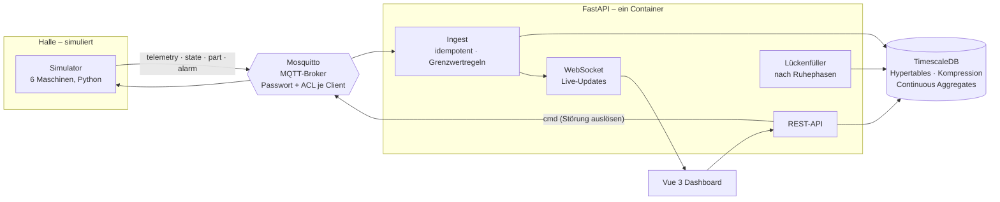

# Maschinen-Monitor – Maschinendaten live statt Kennzahlen am Monatsende

**Live-Demo: https://vue.umut-aslan.dev** · kein Login nötig · alle Besucher sehen dieselbe simulierte Halle

In vielen Fertigungen fallen Stillstände erst auf, wenn jemand vorbeiläuft, und die OEE kommt als Excel-Auswertung am
Monatsende. Der Maschinen-Monitor erfasst Maschinendaten per MQTT, zeigt Zustand und OEE jeder Maschine live, sortiert
Stillstände nach Grund und meldet Alarme – auf Wunsch per Push aufs Handy.

> Demo mit sechs simulierten Maschinen (Fräsen, Drehen, Laser, Biegen, Spritzguss, Montage). Alle Daten sind erfunden.

## So probiert man es aus
1. https://vue.umut-aslan.dev öffnen – die **Halle** zeigt alle Maschinen mit Zustand, OEE der Schicht und Messwerten.
2. Eine produzierende Maschine öffnen und **Störung auslösen**. Zustand, Alarm und Hinweis erscheinen sofort – auch in
   einem zweiten Browserfenster.
3. Unter **Stillstände** die Pareto-Auswertung ansehen (Filter „SGM-01“: die Hydraulik ist das Problem) und
   ungeklärte Stillstände einem Grund zuordnen.
4. Unter **Alarme** quittieren oder Push-Benachrichtigungen einschalten.

## Architektur



| Schicht | Aufgabe | Technik |
|---|---|---|
| **Simulator** | Maschinenverhalten als deterministische Funktion der Zeit: Lauf, Störungen, Rüsten, Pausen, Teile, Messwerte | Python 3.14, aiomqtt |
| **Broker** | Entkoppelt Maschinen und Auswertung; Themen nach Werk/Halle/Maschine | Mosquitto 2, nur intern erreichbar |
| **Backend** | Speichern, Grenzwerte überwachen (Entprellung + Hysterese), OEE und Pareto berechnen, Live-Updates, Web Push | FastAPI, asyncpg, pywebpush |
| **Daten** | Messwerte als Hypertable, nach 2 Tagen komprimiert, nach 14 Tagen gelöscht; Minutenaggregate für lange Zeiträume | TimescaleDB 2.30 (PostgreSQL 17) |
| **Frontend** | Halle, Maschine, Stillstände, Alarme; Diagramme selbst gebaut (SVG), jedes mit Tabellenansicht | Vue 3, TypeScript, Vue Router |

Entscheidungen und Begründungen: [docs/adr](docs/adr).

## Was die Tests absichern

| Ebene | Anzahl | Beispiele |
|---|---|---|
| Domäne (pytest) | 33 | Schichtkalender inkl. Zeitumstellung · OEE-Lehrbuchbeispiel · Grenzwertregel: einzelne Spitze alarmiert nicht, Eskalation, Hysterese · Hydrauliköl wird vor Hydraulikstörungen warm |
| Integration (pytest, echte TimescaleDB + Mosquitto) | 18 | MQTT → Datenbank → Dashboard · doppelt zugestellte Nachrichten zählen einmal · Störung nur an laufender Maschine, mit Sperrzeit · Lückenfüller schreibt dasselbe wie das Modell und nur, was fehlt · Push höchstens alle 5 Minuten · nur Dateien aus dem Build werden ausgeliefert |
| Frontend (Vitest) | 12 | Zeitachsen auf runden Berliner Uhrzeiten · Live-Store · Verlustkaskade |
| End-to-End (Playwright) | 11 | Störung auslösen, zweiter Besucher sieht sie live, Alarm quittieren · Stillstand zuordnen · keine Anfrage verlässt die Seite, keine CSP-Verletzung · kein Querscrollen auf dem Handy |

Dazu `ruff` und `mypy --strict` für das Backend, `vue-tsc` für das Frontend.

## Lokal starten

Voraussetzung: nur Docker.

```bash
cp .env.example .env     # Passwörter setzen; VAPID-Schlüssel optional: ./py.sh run python -m monitor.push
./ops.sh test            # alle Tests, isoliert vom Live-System
./ops.sh deploy          # Tests, dann Start hinter Traefik
```

`./py.sh` und `./node.sh` führen uv bzw. npm im Container aus.

---
Ein Projekt von [Umut Aslan](https://umut-aslan.dev) · [Wie KI bei diesem Projekt eingesetzt wurde](docs/AI-WORKFLOW.md)
